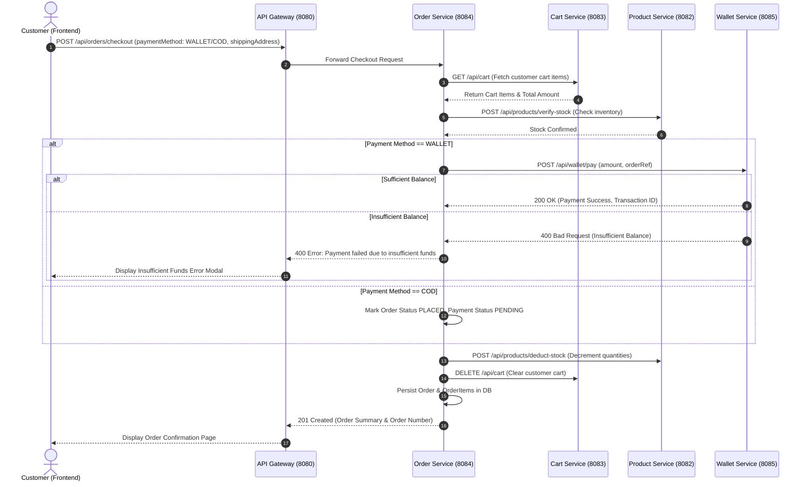

# E-Shopping Zone – E-Cart Management System
## Master Architecture & Implementation Plan

---

### 1. Executive Summary & Requirements Analysis

**E-Shopping Zone** is a production-grade, multi-tier enterprise e-commerce platform built using a microservices architecture. It provides an end-to-end shopping and store management experience for two distinct roles:

1. **Customer**:
   - Guest browsing and catalog exploration without authentication.
   - Comprehensive multi-attribute product search (title, keywords, categories).
   - Category filtering (Electronics, Books, Apparel, Personal Care, Home & Kitchen, Sports & Fitness).
   - User account registration and authentication with secure BCrypt password hashing.
   - Optional GitHub OAuth profile linkage architecture.
   - Detailed product view with inventory/stock availability, specifications, and pricing.
   - Persistent shopping cart management (add, update quantities, delete line items, calculate real-time totals).
   - Seamless checkout pipeline with customizable delivery/shipping address.
   - Dual payment options:
     - **Digital Wallet Payment**: atomic balance verification, fund debit, transaction ledger entry, and instant order confirmation.
     - **Cash on Delivery (COD)**: order placement with deferred payment reconciliation.
   - Customer Order History dashboard with chronological tracking, status tags, and itemized receipts.
   - Wallet Management dashboard: real-time balance display, top-up capabilities, and debit/credit ledger history.
   - User Profile management: update personal details, contact info, and delivery addresses.

2. **Merchant**:
   - Dedicated authenticated merchant portal.
   - Product Catalog Management (CRUD): Create new listings, modify details, update pricing and stock counts, toggle product visibility or delete items.
   - Inventory tracking with low-stock alerts.
   - Merchant Order Fulfillment: view all incoming customer orders across the platform, update order processing state (`PLACED` -> `PROCESSING` -> `SHIPPED` -> `DELIVERED` / `CANCELLED`).
   - Store metrics and order analytics overview.

---

### 2. Technology Stack & Version Compatibility Matrix

To strictly satisfy the **Java 8** target requirement while leveraging battle-tested enterprise microservices tooling, the following mutually compatible version matrix is established:

| Component | Technology | Version | Rationale |
|---|---|---|---|
| **Language** | Java (JDK) | **Java 8 (1.8)** | Strict requirement. No Java 17/21 language features used. |
| **Framework** | Spring Boot | **2.7.18** | Latest stable Spring Boot 2.x release fully compatible with Java 8. |
| **Cloud Suite** | Spring Cloud | **2021.0.8 (Jubilee)** | Officially verified compatible with Spring Boot 2.7.x and Java 8. |
| **Service Registry** | Netflix Eureka Server | Spring Cloud Netflix Eureka | Declarative dynamic service registration and discovery. |
| **API Gateway** | Spring Cloud Gateway | Reactive Spring Cloud Gateway | High-throughput non-blocking routing, CORS, and request forwarding. |
| **Persistence** | Spring Data JPA / Hibernate | Bundled with Spring Boot 2.7.18 | Robust ORM, declarative transactions, repository abstractions. |
| **Database** | MySQL | **8.0+** (Connector 8.0.33) | Enterprise relational storage; isolated service schemas. |
| **Inter-Service Comms**| Spring `RestTemplate` | `@LoadBalanced` | Eureka-resolved service-to-service communication. |
| **Security & Crypto** | Spring Security Crypto / JJWT | BCrypt + JJWT (0.11.5) | Industry standard stateless token-based authorization. |
| **Frontend Framework**| React + TypeScript | **React 18.x + TS 5.x** | Modern, strictly typed component architecture. |
| **Build Tool (UI)** | Vite | **5.x / 6.x** | Instant HMR, rapid bundling, and fast developer loop. |
| **HTTP Client (UI)** | Axios | **1.x** | Interceptor-driven REST communication with API Gateway. |
| **Routing (UI)** | React Router DOM | **6.x** | Declarative client-side routing with role-based Route Guards. |

---

### 3. Microservices Topology & Port Allocations

Each microservice is an independent Maven project that can be compiled, containerized, and run standalone.

```
                     +---------------------------------------+
                     |           React Frontend              |
                     |         (Vite @ Port 5173)            |
                     +-------------------+-------------------+
                                         |
                                  REST Requests
                                         |
                                         v
                     +---------------------------------------+
                     |              API Gateway              |
                     |             (Port: 8080)              |
                     +-------------------+-------------------+
                                         |
                                 Service Discovery
                                         v
                     +---------------------------------------+
                     |             Eureka Server             |
                     |             (Port: 8761)              |
                     +---+-------+-------+-------+-------+---+
                         |       |       |       |       |
            +------------+   +---+---+   |   +---+---+   +------------+
            |                |           |           |                |
            v                v           v           v                v
     +--------------+ +------------+ +-------+ +-----------+ +--------------+
     |   Profile    | |  Product   | | Cart  | |   Order   | |    Wallet    |
     |   Service    | |  Service   | |Service| |  Service  | |   Service    |
     | (Port: 8081) | |(Port: 8082)| |(Port: | |(Port:8084)| | (Port: 8085) |
     +-------+------+ +-----+------+ +---+---+ +-----+-----+ +-------+------+
             |              |            |           |               |
             v              v            v           v               v
      eshop_profile   eshop_product  eshop_cart  eshop_order   eshop_wallet
        _db schema     _db schema    _db schema   _db schema    _db schema
```

#### Microservices Responsibilities:

1. **`eureka-server` (Port: 8761)**:
   - Central discovery registry.
   - Heartbeat tracking and live dashboard at `http://localhost:8761`.

2. **`api-gateway` (Port: 8080)**:
   - Single external gateway interface for the frontend application.
   - CORS policy configuration allowing origins (e.g., `http://localhost:5173`, `http://localhost:3000`).
   - Route definitions mapping `/api/auth/**`, `/api/profile/**` -> `lb://PROFILE-SERVICE`, `/api/products/**`, `/api/categories/**` -> `lb://PRODUCT-SERVICE`, `/api/cart/**` -> `lb://CART-SERVICE`, `/api/orders/**` -> `lb://ORDER-SERVICE`, `/api/wallet/**` -> `lb://WALLET-SERVICE`.

3. **`profile-service` (Port: 8081)**:
   - Manages user accounts, credential verification, roles (`CUSTOMER`, `MERCHANT`), and user profiles.
   - Generates and validates JWT security tokens.
   - Provides public registration, login, and private profile view/update endpoints.
   - Internal helper endpoint for user verification by ID.

4. **`product-service` (Port: 8082)**:
   - Manages product catalog and categorization.
   - Provides public endpoints for catalog browsing, keyword search, and category filtering.
   - Provides merchant endpoints for product creation, modification, stock replenishment, and deletion.
   - Provides internal inter-service endpoint for stock reduction during order processing (`POST /api/products/deduct-stock`).

5. **`cart-service` (Port: 8083)**:
   - Manages active customer shopping carts.
   - Allows adding items, adjusting quantities, deleting items, and wiping cart upon order checkout.
   - Interacts with `product-service` via `@LoadBalanced RestTemplate` to validate current product prices, existence, and stock availability.

6. **`order-service` (Port: 8084)**:
   - Transactional orchestrator for checkout and order fulfillment.
   - Validates items and totals from the cart or checkout payload.
   - For **WALLET** payments: invokes `wallet-service` (`POST /api/wallet/pay`) to deduct the required amount atomically.
   - For **COD** payments: initializes order with `PENDING_PAYMENT` and `COD` payment method.
   - Deducts product inventory by invoking `product-service`.
   - Clears customer cart via `cart-service`.
   - Maintains order status lifecycle: `PLACED`, `PROCESSING`, `SHIPPED`, `DELIVERED`, `CANCELLED`.
   - Exposes customer order history and merchant order management APIs.

7. **`wallet-service` (Port: 8085)**:
   - Customer digital wallet engine.
   - Automatically initializes customer wallet with a starting balance (e.g. $1,000 / ₹5,000 demo credit).
   - Provides balance lookup, top-up/deposit API, and atomic debit/payment processing API.
   - Maintains full double-entry audit log in `wallet_transactions` table (`CREDIT`, `DEBIT`, timestamp, status, reference).

---

### 4. Database Schema Design (MySQL)

In line with standard microservices design, logical data isolation is maintained. Services can target dedicated databases or a consolidated database with prefixed tables:
- `eshop_profile_db`
- `eshop_product_db`
- `eshop_cart_db`
- `eshop_order_db`
- `eshop_wallet_db`

#### 4.1. Profile Service Tables

```sql
-- Users Table
CREATE TABLE users (
    id BIGINT AUTO_INCREMENT PRIMARY KEY,
    username VARCHAR(50) NOT NULL UNIQUE,
    email VARCHAR(100) NOT NULL UNIQUE,
    password_hash VARCHAR(255) NOT NULL,
    role VARCHAR(20) NOT NULL DEFAULT 'CUSTOMER', -- 'CUSTOMER', 'MERCHANT'
    active BOOLEAN NOT NULL DEFAULT TRUE,
    created_at TIMESTAMP DEFAULT CURRENT_TIMESTAMP,
    updated_at TIMESTAMP DEFAULT CURRENT_TIMESTAMP ON UPDATE CURRENT_TIMESTAMP
);

-- Profiles Table
CREATE TABLE profiles (
    id BIGINT AUTO_INCREMENT PRIMARY KEY,
    user_id BIGINT NOT NULL UNIQUE,
    full_name VARCHAR(100),
    phone_number VARCHAR(20),
    address_line1 VARCHAR(255),
    address_line2 VARCHAR(255),
    city VARCHAR(100),
    state VARCHAR(100),
    postal_code VARCHAR(20),
    country VARCHAR(100) DEFAULT 'India',
    avatar_url VARCHAR(500),
    created_at TIMESTAMP DEFAULT CURRENT_TIMESTAMP,
    updated_at TIMESTAMP DEFAULT CURRENT_TIMESTAMP ON UPDATE CURRENT_TIMESTAMP,
    CONSTRAINT fk_profile_user FOREIGN KEY (user_id) REFERENCES users(id) ON DELETE CASCADE
);
```

#### 4.2. Product Service Tables

```sql
-- Categories Table
CREATE TABLE categories (
    id BIGINT AUTO_INCREMENT PRIMARY KEY,
    name VARCHAR(100) NOT NULL UNIQUE,
    description VARCHAR(500),
    icon_name VARCHAR(50),
    created_at TIMESTAMP DEFAULT CURRENT_TIMESTAMP
);

-- Products Table
CREATE TABLE products (
    id BIGINT AUTO_INCREMENT PRIMARY KEY,
    name VARCHAR(255) NOT NULL,
    description TEXT,
    price DECIMAL(10, 2) NOT NULL,
    stock_quantity INT NOT NULL DEFAULT 0,
    category_id BIGINT NOT NULL,
    image_url VARCHAR(500),
    merchant_id BIGINT NOT NULL,
    active BOOLEAN NOT NULL DEFAULT TRUE,
    created_at TIMESTAMP DEFAULT CURRENT_TIMESTAMP,
    updated_at TIMESTAMP DEFAULT CURRENT_TIMESTAMP ON UPDATE CURRENT_TIMESTAMP,
    CONSTRAINT fk_product_category FOREIGN KEY (category_id) REFERENCES categories(id)
);

CREATE INDEX idx_products_category ON products(category_id);
CREATE INDEX idx_products_active ON products(active);
```

#### 4.3. Cart Service Tables

```sql
-- Carts Table
CREATE TABLE carts (
    id BIGINT AUTO_INCREMENT PRIMARY KEY,
    user_id BIGINT NOT NULL UNIQUE,
    created_at TIMESTAMP DEFAULT CURRENT_TIMESTAMP,
    updated_at TIMESTAMP DEFAULT CURRENT_TIMESTAMP ON UPDATE CURRENT_TIMESTAMP
);

-- Cart Items Table
CREATE TABLE cart_items (
    id BIGINT AUTO_INCREMENT PRIMARY KEY,
    cart_id BIGINT NOT NULL,
    product_id BIGINT NOT NULL,
    product_name VARCHAR(255) NOT NULL,
    unit_price DECIMAL(10, 2) NOT NULL,
    quantity INT NOT NULL DEFAULT 1,
    image_url VARCHAR(500),
    created_at TIMESTAMP DEFAULT CURRENT_TIMESTAMP,
    updated_at TIMESTAMP DEFAULT CURRENT_TIMESTAMP ON UPDATE CURRENT_TIMESTAMP,
    CONSTRAINT fk_cart_items_cart FOREIGN KEY (cart_id) REFERENCES carts(id) ON DELETE CASCADE
);

CREATE UNIQUE INDEX idx_cart_product ON cart_items(cart_id, product_id);
```

#### 4.4. Order Service Tables

```sql
-- Orders Table
CREATE TABLE orders (
    id BIGINT AUTO_INCREMENT PRIMARY KEY,
    order_number VARCHAR(64) NOT NULL UNIQUE,
    customer_id BIGINT NOT NULL,
    customer_name VARCHAR(100) NOT NULL,
    customer_email VARCHAR(100) NOT NULL,
    total_amount DECIMAL(10, 2) NOT NULL,
    payment_method VARCHAR(20) NOT NULL,      -- 'WALLET', 'COD'
    payment_status VARCHAR(20) NOT NULL,      -- 'PAID', 'PENDING', 'FAILED'
    order_status VARCHAR(30) NOT NULL,        -- 'PLACED', 'PROCESSING', 'SHIPPED', 'DELIVERED', 'CANCELLED'
    shipping_address TEXT NOT NULL,
    contact_phone VARCHAR(20) NOT NULL,
    wallet_transaction_id VARCHAR(64),
    created_at TIMESTAMP DEFAULT CURRENT_TIMESTAMP,
    updated_at TIMESTAMP DEFAULT CURRENT_TIMESTAMP ON UPDATE CURRENT_TIMESTAMP
);

-- Order Items Table
CREATE TABLE order_items (
    id BIGINT AUTO_INCREMENT PRIMARY KEY,
    order_id BIGINT NOT NULL,
    product_id BIGINT NOT NULL,
    product_name VARCHAR(255) NOT NULL,
    unit_price DECIMAL(10, 2) NOT NULL,
    quantity INT NOT NULL,
    subtotal DECIMAL(10, 2) NOT NULL,
    image_url VARCHAR(500),
    CONSTRAINT fk_order_items_order FOREIGN KEY (order_id) REFERENCES orders(id) ON DELETE CASCADE
);

CREATE INDEX idx_orders_customer ON orders(customer_id);
CREATE INDEX idx_orders_status ON orders(order_status);
```

#### 4.5. Wallet Service Tables

```sql
-- Wallets Table
CREATE TABLE wallets (
    id BIGINT AUTO_INCREMENT PRIMARY KEY,
    user_id BIGINT NOT NULL UNIQUE,
    balance DECIMAL(12, 2) NOT NULL DEFAULT 0.00,
    currency VARCHAR(10) NOT NULL DEFAULT 'INR',
    status VARCHAR(20) NOT NULL DEFAULT 'ACTIVE',
    created_at TIMESTAMP DEFAULT CURRENT_TIMESTAMP,
    updated_at TIMESTAMP DEFAULT CURRENT_TIMESTAMP ON UPDATE CURRENT_TIMESTAMP
);

-- Wallet Transactions Table
CREATE TABLE wallet_transactions (
    id BIGINT AUTO_INCREMENT PRIMARY KEY,
    transaction_id VARCHAR(64) NOT NULL UNIQUE,
    wallet_id BIGINT NOT NULL,
    user_id BIGINT NOT NULL,
    amount DECIMAL(12, 2) NOT NULL,
    type VARCHAR(20) NOT NULL,                 -- 'CREDIT', 'DEBIT'
    status VARCHAR(20) NOT NULL DEFAULT 'SUCCESS', -- 'SUCCESS', 'FAILED', 'PENDING'
    reference_id VARCHAR(100),
    description VARCHAR(255),
    created_at TIMESTAMP DEFAULT CURRENT_TIMESTAMP,
    CONSTRAINT fk_wallet_tx_wallet FOREIGN KEY (wallet_id) REFERENCES wallets(id) ON DELETE CASCADE
);

CREATE INDEX idx_wallet_tx_user ON wallet_transactions(user_id);
```

---

### 5. API Design & Gateway Route Mappings

All client communication is routed through the **API Gateway** on port `8080`.

| Method | Path | Target Microservice | Role / Auth | Description |
|---|---|---|---|---|
| **POST** | `/api/auth/register` | `profile-service` | Public | Register new user (Customer / Merchant) |
| **POST** | `/api/auth/login` | `profile-service` | Public | Authenticate user & return JWT token + role |
| **GET** | `/api/profile/me` | `profile-service` | Authenticated | Retrieve authenticated user profile |
| **PUT** | `/api/profile/me` | `profile-service` | Authenticated | Update user profile details |
| **GET** | `/api/products` | `product-service` | Public | List all active products |
| **GET** | `/api/products/{id}` | `product-service` | Public | Get single product details |
| **GET** | `/api/products/search?q=...` | `product-service` | Public | Search products by keyword |
| **GET** | `/api/products/category/{catId}`| `product-service` | Public | Filter products by category |
| **POST** | `/api/products` | `product-service` | Merchant | Add a new product |
| **PUT** | `/api/products/{id}` | `product-service` | Merchant | Update an existing product |
| **DELETE**| `/api/products/{id}` | `product-service` | Merchant | Delete or deactivate product |
| **GET** | `/api/categories` | `product-service` | Public | List all product categories |
| **POST** | `/api/categories` | `product-service` | Merchant | Add a new category |
| **GET** | `/api/cart` | `cart-service` | Customer | Get customer's current cart and items |
| **POST** | `/api/cart/items` | `cart-service` | Customer | Add product to cart |
| **PUT** | `/api/cart/items/{itemId}` | `cart-service` | Customer | Update quantity in cart |
| **DELETE**| `/api/cart/items/{itemId}` | `cart-service` | Customer | Remove specific item from cart |
| **DELETE**| `/api/cart` | `cart-service` | Customer | Clear all items from cart |
| **POST** | `/api/orders/checkout` | `order-service` | Customer | Execute checkout (Wallet or COD) |
| **GET** | `/api/orders/my-orders` | `order-service` | Customer | View customer order history |
| **GET** | `/api/orders/{id}` | `order-service` | Authenticated | View detailed order receipt |
| **GET** | `/api/orders/merchant/all` | `order-service` | Merchant | View all customer orders |
| **PUT** | `/api/orders/{id}/status` | `order-service` | Merchant | Update order progress status |
| **GET** | `/api/wallet/balance` | `wallet-service` | Customer | Get current wallet balance |
| **POST** | `/api/wallet/topup` | `wallet-service` | Customer | Deposit funds to wallet |
| **POST** | `/api/wallet/pay` | `wallet-service` | Internal/Customer | Deduct balance for order payment |
| **GET** | `/api/wallet/transactions` | `wallet-service` | Customer | View wallet transaction history |

---

### 6. Checkout & Payment Sequence



---

### 7. Frontend UI Structure & Component Hierarchy

Built using **Vite + React 18 + TypeScript**:

```
frontend/
├── index.html
├── package.json
├── tsconfig.json
├── vite.config.ts
└── src/
    ├── api/
    │   ├── client.ts             # Axios instance configured with Gateway URL & Auth Interceptor
    │   ├── authApi.ts
    │   ├── productApi.ts
    │   ├── cartApi.ts
    │   ├── orderApi.ts
    │   └── walletApi.ts
    ├── components/
    │   ├── common/
    │   │   ├── Navbar.tsx        # Responsive navigation, role toggles, search, cart counter
    │   │   ├── Footer.tsx        # Professional footer with links and academic disclaimer
    │   │   ├── ProtectedRoute.tsx# Role-based route authorization guard
    │   │   ├── Modal.tsx
    │   │   ├── Toast.tsx
    │   │   └── Spinner.tsx
    │   ├── product/
    │   │   ├── ProductCard.tsx   # Card with image, price, stock badge, quick add-to-cart
    │   │   └── CategoryNav.tsx   # Visual category pills / horizontal scroll
    │   └── cart/
    │       └── CartDrawer.tsx
    ├── context/
    │   ├── AuthContext.tsx       # Auth state, login/logout, role, user profile
    │   ├── CartContext.tsx       # Live cart counter, cart items, sync with backend
    │   └── WalletContext.tsx     # Current balance, refresh trigger
    ├── pages/
    │   ├── Home.tsx              # Hero carousel, featured categories, trending products
    │   ├── ProductListing.tsx    # Search, category filter, price sorting, grid view
    │   ├── ProductDetail.tsx     # Large gallery, full description, quantity selector
    │   ├── Login.tsx             # Customer & Merchant quick-login buttons + form
    │   ├── Register.tsx          # Account creation with prefilled demo data option
    │   ├── Cart.tsx              # Full cart table, item subtotal, checkout button
    │   ├── Checkout.tsx          # Address entry, payment method picker (Wallet / COD)
    │   ├── OrderConfirmation.tsx # Success banner, tracking number, itemized receipt
    │   ├── MyOrders.tsx          # Order history cards, tracking timeline, item details
    │   ├── Wallet.tsx            # Digital wallet card, instant top-up form, transaction ledger
    │   ├── Profile.tsx           # User contact and shipping address settings
    │   └── merchant/
    │       ├── MerchantDashboard.tsx # Overview statistics, low-stock warnings, orders overview
    │       ├── ProductManage.tsx     # CRUD table, add product modal, stock editor
    │       └── OrderManage.tsx       # Master orders table, status transition dropdown
    ├── types/
    │   └── index.ts              # Strongly typed TypeScript interfaces (User, Product, Order, etc.)
    └── styles/
        └── index.css             # Polished modern CSS theme, clean layout, responsive grid
```

---

### 8. Seed Data & Demonstrability

To ensure the application is immediately ready for office/academic demonstration without manual data entry:

1. **Default Users**:
   - **Customer**: `customer@eshop.com` / `password123` (Role: `CUSTOMER`, Initial Wallet: ₹10,000 / $1,000)
   - **Merchant**: `merchant@eshop.com` / `password123` (Role: `MERCHANT`)

2. **Default Product Categories**:
   - `Electronics`
   - `Books`
   - `Apparel`
   - `Personal Care`
   - `Home & Kitchen`
   - `Sports & Fitness`

3. **Sample Products**:
   - 20 realistic products distributed across categories with pricing, realistic inventory (5 to 50 units), descriptions, and high-quality image URLs.

---

### 9. Phased Implementation Roadmap

- **Phase 1 (Current)**:
  - Architecture Analysis & Design (PROJECT_PLAN.md).
  - Scaffold complete Maven multi-module backend and React Vite TypeScript frontend structure.
  - Setup parent POM and submodule POM files with Spring Boot 2.7.18 and Spring Cloud 2021.0.8 (Java 8).
- **Phase 2**:
  - Eureka Discovery Server implementation & configuration.
  - Spring Cloud API Gateway implementation with routing filters and CORS configuration.
- **Phase 3**:
  - Implementation of Domain Entities, Repositories, DTOs, Services, and REST Controllers for:
    - Profile Service (with BCrypt security, JWT generation/validation).
    - Product Service (with categories and inventory management).
    - Cart Service (with RestTemplate client to Product Service).
    - Wallet Service (with balance management, transaction ledger, debit/credit APIs).
    - Order Service (with multi-service checkout coordination for Wallet and COD).
- **Phase 4**:
  - Database initialization scripts (`schema.sql` and `data.sql` / flyway / hibernate auto-ddl).
  - Inter-service RestTemplate client integration and error handling.
- **Phase 5**:
  - Frontend implementation: components, contexts, pages, responsive styling, and API integration.
- **Phase 6**:
  - End-to-end integration testing, sample seed data validation, running instructions, and demo guide.
